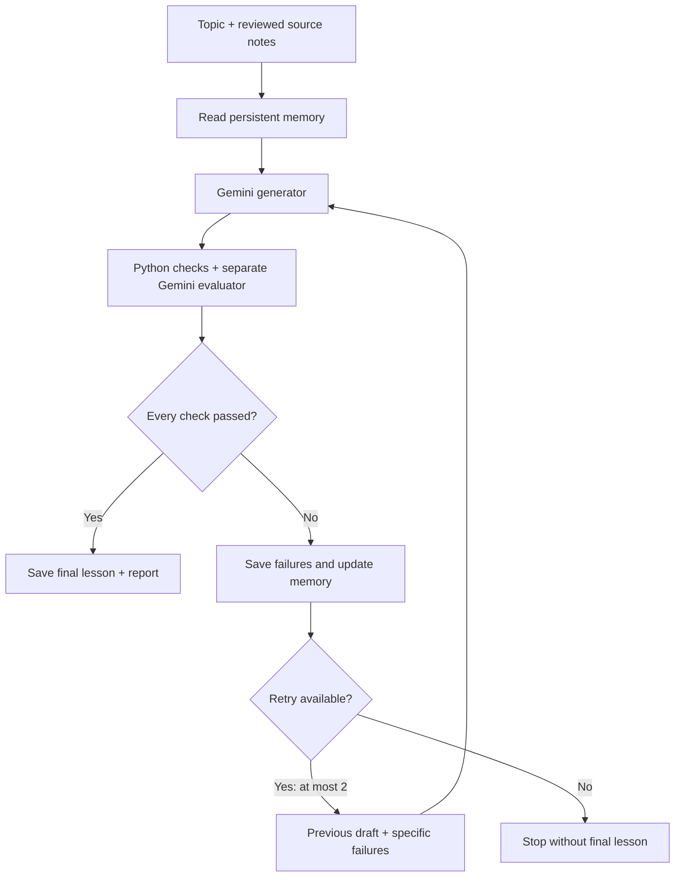

# Lesson Loop

A beginner lesson writer with a strict quality gate. Built for the NxtWave GenAI Engineer – Content Systems assessment.

The topic for this submission is **Introduction to RAG**. The learner has finished class 12 in India, has limited English, and has no AI background.

The system writes a lesson, reviews it, and sends specific failures back for revision. A lesson is released only when **every check passes**. After two retries, it stops and keeps the rejected drafts for inspection.

**Model:** `gemini-3.8-flash`, used in separate generator and evaluator calls. Supports Vertex AI with Application Default Credentials (ADC), or the Gemini Developer API with a key.

**Verified:** [actual rejection-and-repair run](examples/live-run/report.json), [seven live evaluator cases](examples/calibration/summary.json), and 29 passing core tests plus seven dashboard tests. The final [666-word lesson](docs/final-lesson.md) passed every check on the second attempt. See [verification details](docs/verification.md) for the limits of these results.

**Lesson document:** [Introduction to RAG](https://docs.google.com/document/d/1M8x9AH2NAMaNV1cddtMwc0Ru9kqQyn1l-mWA9ABNrmA/edit).

## Local dashboard

The optional Streamlit dashboard uses the same pipeline as the CLI. It shows live progress, per-attempt checks, revision diffs, memory snapshots, and downloads for the lesson and rejection log.

```powershell
python -m pip install -r requirements-ui.txt
python -m streamlit run app.py
```

Open the local URL printed by Streamlit (normally `http://127.0.0.1:8501`). On Windows, `start-dashboard.cmd` launches it from the right folder, using a local `.venv` if present. The saved, real passing example is available immediately without credentials or new model calls.

For a new run, configure Vertex ADC as below. The dashboard automatically detects the project from your default ADC credentials, with the ADC quota project as a fallback. An explicit `GOOGLE_CLOUD_PROJECT` takes priority, and you can override the project in the sidebar. No login or model call runs just from opening the dashboard. Choose a retry limit and optionally enable deliberate-error injection, then click **Generate & evaluate**. Reviewing saved results and downloading files do not trigger generation. Only one generation can run at a time in this local app.

The dashboard binds to loopback and uses the computer's credentials; it is intended for local demonstrations. Custom topics still require appropriate source notes and rubric changes.

## Start here

You need Python 3.10 or newer. Run commands from this repository's root.

### Vertex AI with ADC

Your Google Cloud project needs billing, the Vertex AI API enabled, model access, and appropriate Vertex AI permissions. These commands use your own project; no personal project ID or credentials are shipped in the repo.

```powershell
python -m venv .venv
.venv\Scripts\Activate.ps1
python -m pip install -r requirements-vertex.txt
gcloud auth application-default login
$env:LLM_BACKEND = "vertex"
$env:GOOGLE_CLOUD_PROJECT = "your-project-id"
$env:GOOGLE_CLOUD_LOCATION = "us"
python -m lesson_loop generate
```

The client supports the global, US and EU multi-region endpoints. The setup above uses `us`; the default is `global` if no location is supplied. ADC tokens stay in memory and never enter the saved reports.

### Gemini API key

This route needs no Python dependencies.

```powershell
$env:LLM_BACKEND = "gemini"
$env:GEMINI_API_KEY = "your-key"
python -m lesson_loop generate
```

On macOS/Linux, set variables with `export NAME=value` and activate a venv with `source .venv/bin/activate`.

`.env.example` documents the variable names. The app does **not** automatically load `.env` files. Do not commit keys, access tokens or ADC files.

## Show the full loop

```powershell
python -m lesson_loop generate --inject-error
```

This makes a real generator call and appends one deliberately wrong claim to its first draft:

> RAG always gives correct answers, even when its source notes are wrong.

The evaluator sees that claim as part of the candidate. It gets no special hint that this is a demo. Its verdict determines whether the candidate is rejected. The next generator receives the failed checks and the whole previous lesson. No replacement lesson or passing judgment is hardcoded.

Fault injection runs are labelled in the report and excluded from production memory. They test the quality gate without teaching the system from errors we deliberately inserted.

## What gets saved

Each command creates a fresh `runs/<run-id>/` folder:

- `attempt-1.md`, etc.: the actual drafts, including rejected ones.
- `attempt-1-input.json`, etc.: generator inputs, including memory guidance and retry feedback.
- `attempt-1-judge.json`, etc.: actual model judgments.
- `attempt-2-changes.diff`, etc.: real text differences between attempts.
- `source-pack.json` and `rubric.json`: the reference notes and fixed rubric snapshot.
- `report.json`: status, all check results, memory before/after, model versions, latency and token usage.
- `rejection-log.md`: failures and changes in readable form.
- `lesson.md`: created **only** when all checks pass.

Statuses are `passed`, `exhausted` or `error`. Exit code is 0 for a passing run and 2 otherwise. A malformed judge, blocked response, unavailable model or exhausted quota stops the run. None is treated as a pass.

## The rubric

There are 12 binary checks. There is no average score and no partial credit.

Four Python checks cover:

- **Length:** 500–900 words before the source list.
- **Structure:** eight required headings, appearing once and in order.
- **Sentence length:** average at most 18 words; no sentence above 35 words.
- **Citations:** at least one inline source ID; every cited ID exists in the pack.

Eight model checks cover:

- **Accuracy:** claims agree with the supplied notes.
- **Coverage:** meaning, need and complete basic process.
- **Language:** familiar English for the intended learner.
- **Jargon:** technical terms explained on first use.
- **Example:** a fictional, familiar situation with a question, source, lookup and supported answer.
- **Limitations:** wrong/missing sources, possible mistakes, and an honest missing-evidence response.
- **Flow:** motivation, definitions, steps, practice, recap.
- **Practice:** exactly three questions with answers, covering meaning, new application and missing evidence.

The full requirements are in `lesson_loop/rubric.py`. Each model verdict includes a reason and supporting evidence line numbers, or an empty list for an absent requirement. Python validates IDs, booleans, source IDs and line numbers, then extracts the actual lesson excerpts itself. This avoids asking the model to reproduce quotations perfectly. Valid references prove the excerpts exist; they do not prove the judge's reasoning is correct.

## Memory and self-evolution

`data/memory.sqlite3` persists failures across runs. A repeated failure on the same check in **two distinct runs** activates a short, predefined instruction in later generator prompts. Multiple failed attempts within one run count once.

For example, repeated jargon failures activate: “Explain technical words immediately on first use, or remove them.” The report saves the guidance actually used. Memory is scoped to the topic, source-pack hash and rubric version.

Human feedback can also be recorded:

```powershell
python -m lesson_loop feedback --check jargon --note "A learner could not explain the word context."
python -m lesson_loop memory
```

One human feedback event counts as one observation. The raw note is saved for inspection, but only the known check ID can select guidance. This avoids turning arbitrary feedback into instructions. Memory improves generation prompts; it **does not weaken or rewrite the quality bar**. This is bounded prompt adaptation, not model training or proof of learning effectiveness.

## How it is built



`pipeline.py` owns the state transitions; `model.py` handles authentication and HTTP; `rubric.py` owns the gate; `memory.py` persists failure counts. Python plus an API is an allowed assessment stack. A small explicit loop makes this workflow easier to inspect than an orchestration framework with the same three steps.

The reference pack is deliberately small and reviewed. The app passes all its notes to the model; it does not crawl the web or implement a vector search engine. It is a lesson generator **about** RAG. Custom topics need their own reviewed source pack and appropriate topic-specific rubric wording.

## Tests and evaluator calibration

```powershell
python -m unittest discover -s tests -v
python evaluate_cases.py
```

Unit tests run without credentials. They use explicit fake model outputs to test control flow, contracts, stopping, memory, error handling and output safety. The 29 core tests require no extra packages. Installing `requirements-ui.txt` also enables seven dashboard tests; otherwise those are skipped. They do not establish whether Gemini is a good judge.

`evaluate_cases.py` makes seven **live** evaluator calls: a reference lesson, a false guarantee, unexplained jargon, missing practice, a false claim paired with prompt injection, false certainty about wrong sources, and unexplained terms such as parameters. It saves every verdict and fails if the expected check is not caught, or if the reference lesson is rejected. An evaluator may reject a reference lesson for a valid reason; inspect mismatches instead of changing an expected result just to get green output. Seven cases are a starting calibration set, not a statistical benchmark.

GitHub Actions runs the core tests on Python 3.10 and 3.12, plus the dashboard tests in a separate Python 3.12 job.

## Limits and next steps

Using the same model for writing and reviewing can produce shared blind spots. Separate calls help but do not remove that risk. I would next add human-labelled examples, measure false passes and false rejections, and compare a second judge before expanding the content library.

The sentence rule is a simple readability proxy. Only learner testing can tell us whether the lesson is understandable. The source pack needs periodic human review; facts are not refreshed automatically. Prompt injection instructions and structured output reduce risk but are not a complete security boundary.

One content attempt uses two logical model calls. The content loop allows at most six, with at most three bounded HTTP attempts per call. Network timeouts are 90 seconds each. Reports record actual usage rather than assuming a price or a fixed response time. The SQLite store is intended for one local process; larger deployments need stronger concurrency and retention controls.

## Project documentation

- `docs/design.md`: planning, choices, rubric rationale and trade-offs.
- `docs/final-lesson.md`: the generated lesson that passed all checks.
- `docs/verification.md`: test results and live verification details.
- `examples/reference-lesson.md`: a prepared teaching reference and test fixture; not a claimed model output.
- `examples/live-run/`: the actual passing run, including drafts, evaluation results and revision history.

## References

The source pack links to [Google Cloud's RAG overview](https://cloud.google.com/use-cases/retrieval-augmented-generation) and the [original RAG paper](https://arxiv.org/abs/2005.11401). Transport follows the official [Gemini structured output documentation](https://ai.google.dev/gemini-api/docs/generate-content/structured-output), [Gemini 3.8 Flash on Google Cloud](https://docs.cloud.google.com/gemini-enterprise-agent-platform/models/guides/gemini-3-8-flash), and [endpoint documentation](https://docs.cloud.google.com/gemini-enterprise-agent-platform/resources/locations).
